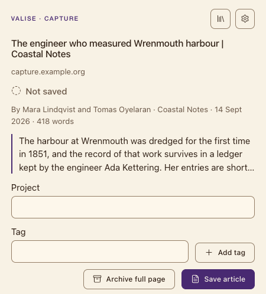
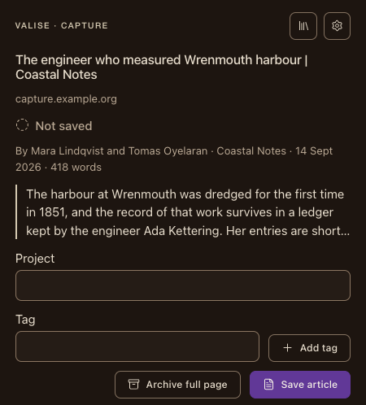
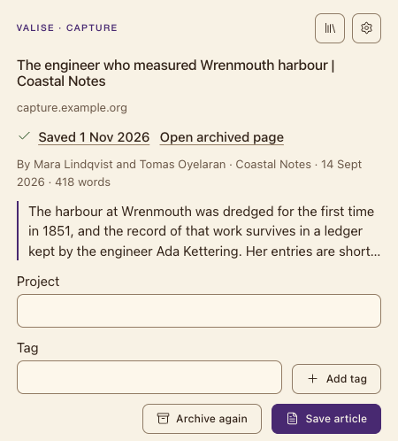
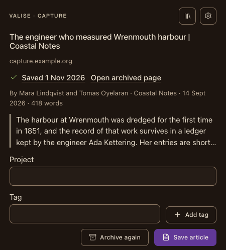
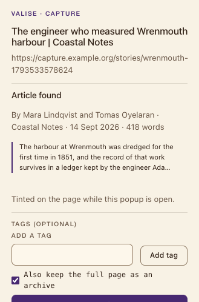
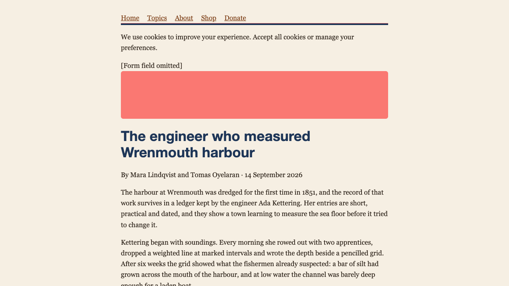

# Chrome extension popup and styled archive

Contract: `docs/operations/chrome-capture.md`, "Popup interaction contract",
and ADR-0015, amendments of 2026-10-30. Plan:
`docs/plans/2026-10-30-extension-archive.md`.
Queue: `todo:tdo_0a1e741f-cc80-41f1-8321-dfe7ce0e14d4`.

## Default view and primary action

The popup is 450px wide; extension 0.6.0's was 329px. It opens on the page's
title and host, then whether Valise already holds a source at that exact URL:
a check and "Saved <date>" linking to it in Library, with "Open archived page"
when it has an archive, or a dashed circle and "Not saved", or an alert and
"Could not check whether this page is saved" when Valise did not answer.
Then the article the extractor found, and a Project field and a Tag field
whose suggestion lists offer the owner's 50 most used projects and tags.
Bottom right, the primary is Save article when an article was found and
Save bookmark when not, with Archive full page (Archive again on a page
that has an archive) as the outlined secondary to its left. Tags and project
stay editable after a save and write a new revision of the saved source.
Open Library and Settings are icons top right. Text is at the console's
15px; Chrome's own 75% rule for extension pages is overridden.
Nothing in the status line says the popup is ready; the enabled controls do.

P13 governs the saved state, the link is the item, and the empty status line.
P9 governs the offered projects and tags. V1, V2, V6 and V7 govern
the look; the popup reads the console's roles from the same stylesheet, and
follows the system theme.

## Browser walkthrough

`node scripts/extension-shots.mjs`, with `npm run dev` running, loads the
unpacked extension in Chromium, connects it with a capture-scoped token, opens
a routed copy of `test/ui/fixtures/article-capture.html` with a site
stylesheet and a banner image, and screenshots the real action popup before
and after archiving the page, in both themes. It then follows Open archived
page through the console session to the viewer.

| State | Light | Dark |
|---|---|---|
| Not saved |  |  |
| Saved |  |  |

Extension 0.6.0 on the same page, for comparison: the primary action is
below the popup's visible height.

The archived page in the viewer, rendered from its folder: the stylesheet's
type, colours and column width, the banner `` and the header's CSS
background image.

## Evidence boundary

The fixtures are generated and non-private. The walkthrough covers one page
with a same-origin stylesheet. Cross-origin stylesheets and fonts are covered
by a hand run of `capturePage` only, and pages whose CDN refuses CORS keep
their markup without those files. Chrome's native site-access dialog is not
exercised.
