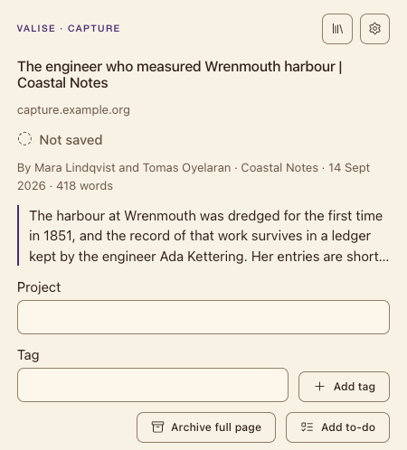
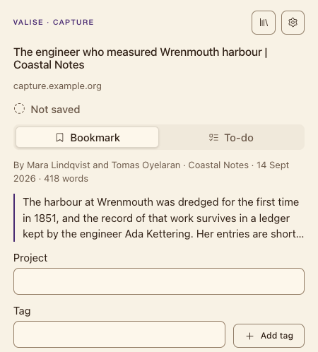
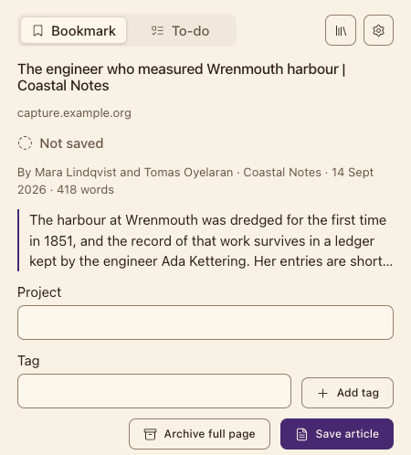
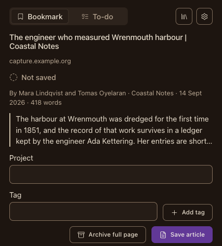
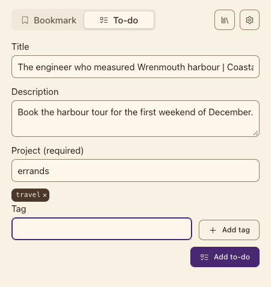
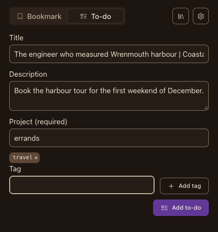
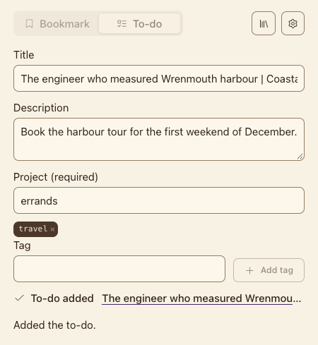
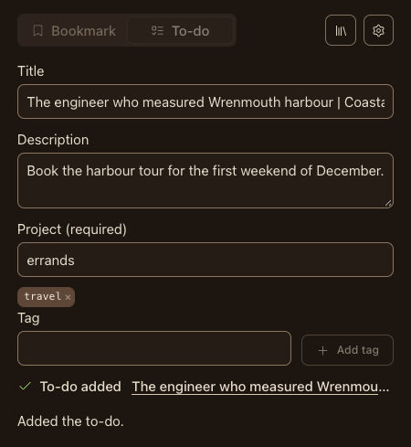

# Chrome extension: a page as a to-do

Contract: `docs/operations/chrome-capture.md`, "To-do from the page", and
ADR-0004, amendment of 2026-11-01.
Queue: `todo:tdo_efde7f23-a29e-4e97-884a-ea3add4ce5e8`.

## Where the to-do control goes

The to-do assumed a Bookmark | To-do switch at the top of the save area and
asked screenshots to settle it against a third button in the save row. A
throwaway script rendered both on the real action popup, over the routed
article fixture, at 450px wide. Headless Chromium sizes the popup to its
content up to about 500px.

| Third button in the save row | Switch under the page header | Switch in the header row |
|---|---|---|
|  |  |  |

Three buttons do not fit one row at this width: Save article wraps to a second
row, out of view. The switch under the page header adds 48px, and Save article
drops out of view the same way. In the header row, where the eyebrow "Valise ·
Capture" stood, the Bookmark side keeps the height it had before and its
primary in view. The eyebrow still shows on the sign-in prompt and on a page
that cannot be saved.

A third button would also have needed a second step to reveal the title and
description fields, which is a mode switch with no visible state.

## Default view and primary action

`npm run shots:extension` against `npm run dev`, with a pasted token holding
the four scopes.

| State | Light | Dark |
|---|---|---|
| Bookmark side |  |  |
| To-do side, filled in |  |  |
| To-do added |  |  |

The To-do side hides the page header: the Title field carries the page's
title and the to-do links the page. That keeps Add to-do in view, 479px of
content against 526px on the Bookmark side. Once added, the to-do's title
links it in the console on one line, ellipsized.

## Evidence boundary

Data integrity: `test/mcp/oauth.worker.test.ts` proves the 0.7.0 request
still gets exactly three scopes, and a four-scope request can `create_todo`
from the extension's Origin and still cannot `save_memory`.
`clients/chrome-extension/test` covers `createTodo`'s arguments, the long-URL
body line, the insufficient-scope error, and which grants Connect accepts.

Browser usability: `test/ui/chrome-extension-loaded.spec.ts` connects the
built extension through the real consent page with four scopes, refuses Add
to-do without a project, adds a to-do, opens it in the console with its
description, project, tag and `url` ref, and shows the reconnect notice for a
stored grant with no `scopes`, the shape 0.7.0 leaves.

Not covered: a real 0.7.0 install upgraded in Chrome, and the popup in real
Chrome, where the height limit is 600px rather than headless Chromium's.
Production is unobserved until the merge deploys.
